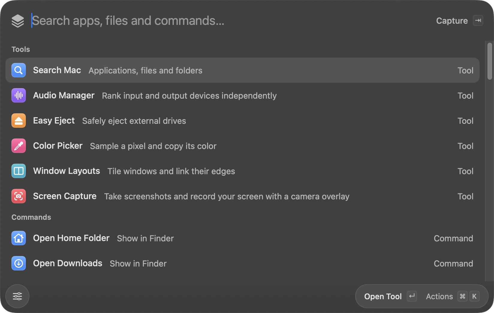

# Shad Tools

A keyboard-first toolbox for macOS. One palette finds apps and files, ranks audio devices, ejects drives, samples colors, arranges windows, captures screenshots or recordings, inspects and reuses clipboard entries, and maps mouse buttons to a shortcut dial and gestures. Use **⌘K** on a result to see its actions. Shad Tools runs locally. Capture uploads are optional.



## Install

Download the **Shad Tools** package for the complete palette, or pick one of the eight standalone installers. Each installer contains a self-contained application for Apple silicon and Intel Macs targeting macOS 13 or later. Open the installed app from Applications. [Download version 0.5.0](https://github.com/SyedShad/shad-tools/releases/tag/v0.5.0)

| Installer | What it does | Default shortcut |
| --- | --- | --- |
| [Shad Tools](https://github.com/SyedShad/shad-tools/releases/download/v0.5.0/Shad-Tools-0.5.0.pkg) | All eight tools in one menu bar app | ⌃⌥Space |
| [Shad Search](https://github.com/SyedShad/shad-tools/releases/download/v0.5.0/Shad-Search-0.5.0.pkg) | Search apps, commands, filenames, and paths | ⌃⌥⌘S |
| [Shad Audio](https://github.com/SyedShad/shad-tools/releases/download/v0.5.0/Shad-Audio-0.5.0.pkg) | Rank microphones and playback devices independently | ⌃⌥⌘A |
| [Shad Eject](https://github.com/SyedShad/shad-tools/releases/download/v0.5.0/Shad-Eject-0.5.0.pkg) | Safely eject one physical drive or all eligible drives | ⌃⌥⌘D |
| [Shad Color](https://github.com/SyedShad/shad-tools/releases/download/v0.5.0/Shad-Color-0.5.0.pkg) | Sample a pixel and copy HEX, RGB, or HSL | ⌃⌥⌘C |
| [Shad Windows](https://github.com/SyedShad/shad-tools/releases/download/v0.5.0/Shad-Windows-0.5.0.pkg) | Tile windows, snap adjacent edges, and resize linked windows | ⌃⌥⌘W |
| [Shad Capture](https://github.com/SyedShad/shad-tools/releases/download/v0.5.0/Shad-Capture-0.5.0.pkg) | Screenshots, annotations, Studio, and screen recordings with a camera overlay | ⌃⌥⌘P |
| [Shad Clipboard](https://github.com/SyedShad/shad-tools/releases/download/v0.5.0/Shad-Clipboard-0.5.0.pkg) | Inspect, edit, pin and paste text, images, files, links, emails and colors | ⌃⌥⌘V |
| [Shad Mouse](https://github.com/SyedShad/shad-tools/releases/download/v0.5.0/Shad-Mouse-0.5.0.pkg) | Eight-slot dial, app-specific shortcuts and four directional gestures | ⌃⌥⌘M |

Version 0.5.0 is a public preview. The apps are ad hoc signed. The installers are unsigned and have no Apple notarization ticket, so Gatekeeper may stop a downloaded package. Apple's guide explains the alert and the per-item approval option available on some Macs. You can also build the tagged source below. [Apple’s guide to opening downloaded software](https://support.apple.com/en-us/102445)

To verify a single download, run `shasum -a 256` followed by the path to the package and compare the result with the line for that filename in the [release checksum manifest](https://github.com/SyedShad/shad-tools/releases/download/v0.5.0/SHA256SUMS-0.5.0.txt).

## First use

- Press **Control + Option + Space** or click the suite’s menu bar icon. Type to search across tools, or open a category to browse its commands. Use **↑**, **↓**, and **Return**. **Escape** clears the query, goes back, or closes the palette.
- Press **Control + Option + Command + V** in any app to open **Clipboard History**. Select an entry to see where it came from, when it was copied and details specific to its type. **⌘K** opens its actions, including format selection, editing, image text recognition and saving. **Return** pastes into the previous app and **⌘Return** copies. Change the shortcut in Shad’s keyboard settings. [Clipboard history guide](docs/clipboard.md)
- Open **Mouse Tools → Configure Mouse Tools** and enable mouse input. With the default binding, tap the middle button to open the dial or hold it, move up, down, left or right, and release to run a gesture. The four left dial actions stay the same across apps. The four right actions follow the foreground app. [Mouse setup and dial preview](docs/mouse.md)
- Open **Audio Manager → Manage Input Priorities**. Put the MacBook microphone above the headset microphone. Under **Manage Output Priorities**, put the headset above the speakers. Shad uses the highest connected device on each list and restores it if macOS changes the default. [Audio priority guide](docs/hardware.md)
- Open **Screen Capture** for region, window, display, scrolling, OCR and recording commands. **Record Screen with Camera** places your camera over a display or window and saves the result as MP4. You can change its size, position, shape, or background. [Capture and Studio](docs/capture.md) · [Presenter recording](docs/camera.md)
- Press **Control + Option + Command + E** to eject eligible external drives. Wait for the result before unplugging. For one specific drive, select its command and press **⌘K → Set Keyboard Shortcut**. [Drive behavior and busy disks](docs/hardware.md#leave-with-your-drives)
- Focus a window and press **Control + Option + Command + an arrow** to tile it to that half of the display. Grant Accessibility access when macOS requests it. Drag one window beside another until the snap preview appears, then drop and resize their shared edge. [Window layouts and magnetic resizing](docs/windows.md)
- Select **Pick Screen Color as HEX**, move the magnifier over a pixel, and click. The result is ready to paste. [Search and color guide](docs/search-color.md)
- Use **⌘,** or the sliders button for shortcuts, appearance and **Start at login**. Choose System, Light or Dark for each edition. A warning beside a binding means another app or macOS already uses it. Control-click the menu bar icon to quit. Running both the suite and a standalone copy of the same tool can create competing bindings. Choose the edition you want to keep running.

## Build and test

On macOS with recent Xcode or Command Line Tools and Swift 6 or newer:

```sh
git clone --branch v0.5.0 https://github.com/SyedShad/shad-tools.git
cd shad-tools
./scripts/test.sh
./scripts/package.sh
./scripts/verify-packages.sh
open "dist/apps/Shad Tools.app"
```

The release script creates nine universal installers, app bundles, and a SHA-256 manifest in `dist/`. Each edition has its own bundle ID and initializes only its own tools. Shad Audio and the suite share device rankings. The release script downloads and verifies the pinned MacShot engine and its sources for the Capture and suite editions. Those two packages work without a separate MacShot installation.

To check downloaded packages, place all nine and the manifest in one directory and run `shasum -a 256 -c SHA256SUMS-0.5.0.txt` there. Maintainers can set `APP_SIGN_IDENTITY`, `INSTALLER_SIGN_IDENTITY`, and `NOTARY_PROFILE` when running the release script with their own Developer ID certificates and notarytool keychain profile.

## Project

The keyboard interaction takes inspiration from Raycast's search and hotkey walkthroughs, and the tiling commands follow familiar Rectangle layouts. The feature guides link the native APIs and design references. [Raycast quickstart and video](https://manual.raycast.com/quickstart) · [Rectangle](https://github.com/rxhanson/Rectangle)

The Shad Tools source is available under the [MIT license](LICENSE). The bundled MacShot application is licensed under GPLv3 and includes its corresponding source and third-party notices. [MacShot attribution](ThirdParty/MacShot/NOTICE.md)
