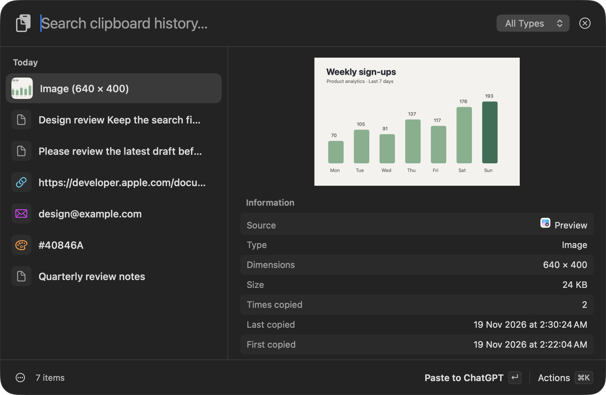
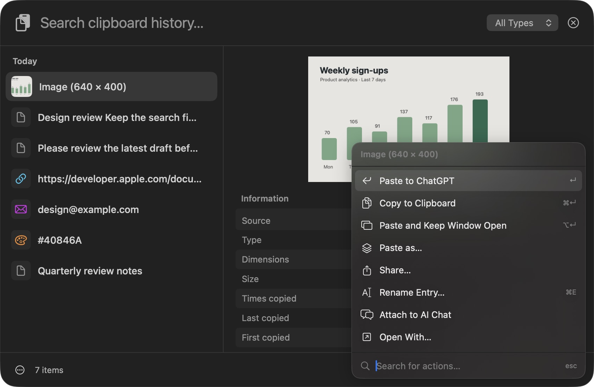

# Clipboard History

Press **Control + Option + Command + V** in any app. Use **↑** and **↓** to select an entry and **⌘K** to search its actions. The same history and saved snippets are available from Shad Tools and standalone Shad Clipboard. Change the global shortcut in Shad’s shortcut settings.

## Inspect an entry

The preview shows the copied text, image, file list, link, email address or color swatch. Scroll the **Information** section for the source application, type, size, copy count, time and available paste formats. Shad uses the source identified by the pasteboard when available, and otherwise uses the app in front when it observes the copy. Repeated copies show the first and last recorded times. Text entries also have character, word and line counts. Images have pixel dimensions. A copied file group shows its file names and paths together.

Type in the history search to find content, renamed entries, file paths, source application names or recognized text in images. **⌘P** opens the type filter, including pinned entries and saved snippets. With an entry selected, click **Actions** or press **⌘K** to search the actions for that item.

## Paste, edit and reuse

| Action | What it does |
| --- | --- |
| **Paste to [app]** · Return | Restores the entry to the clipboard and pastes it into the app you were using. |
| **Copy to Clipboard** · ⌘Return | Restores the entry with its captured formats for manual pasting. |
| **Paste and Keep Window Open** · ⌥Return | Pastes into the previous app and returns to your selection in history. |
| **Paste as…** | Chooses an available representation, such as plain text, RTF, HTML, TIFF or PNG. Shad keeps original formats and grouped pasteboard items within its storage limits. |
| **Edit Content** / **Rename Entry** | Changes the text itself or gives the entry a searchable display name. Editing text replaces its original rich formatting. |
| **Pin Entry** · ⌘. | Keeps the entry at the top and protects it from automatic eviction and recent-entry cleanup. |
| **Save as Snippet** | Saves a separate, named text snapshot. Choose **Snippets** in the filter to find, edit, copy or paste it. It survives changes to the original entry and clearing clipboard history. |
| **Share** / **Save as File** | Opens the macOS share picker or a save dialog for the selected content. |

Direct paste needs Accessibility access for the Shad edition you use. If access is missing, Shad puts the selected item on the clipboard and you can press **⌘V** in the destination app.

## Actions by content type

- **Images** support Quick Look, Open With, Show in Finder and Annotate in Preview. Use Preview’s Markup toolbar and save your edits. Finder can reveal the working copy. The original clipboard image stays available for pasting and exporting. **Copy Text from Image** uses on-device recognition. **Copy Text from QR Code** copies the decoded contents.
- **Files** can be opened together, revealed in Finder, previewed with Quick Look or copied as paths. Shad records references to the original files. File actions require those files to remain accessible.
- **Links and email addresses** can open the link or start a draft in the default email app. **Colors** can be copied as HEX, RGB or HSL, including transparency. JSON objects and arrays have a **Copy Formatted JSON** action.
- **Send to AI Chat** or **Attach to AI Chat** opens a Shad conversation with the selected item. On an eligible Apple silicon Mac with an available Apple Intelligence model, you can ask questions locally. On-device image understanding requires macOS 27 and a compatible SDK build. Earlier supported models can use recognized image text. Local chat can read supported text files, text-based PDFs and images. **Open in Chat App** opens a blank ChatGPT or Claude conversation in your browser and puts the item on the clipboard for you to paste.

## Storage and controls

Shad begins collecting with the next copy after launch. Clipboard history, named snippets and recognized text are stored on this Mac. The history budget is 200 entries and 100 MiB, with a 16 MiB content limit per entry. A single image can be kept as PNG when its original formats exceed that limit but its PNG fits. Pins are kept during automatic cleanup. The **History actions** menu lets you pause collection. **Delete Recent Entries** offers 5, 15 or 30 minutes, 1 hour, or 24 hours. **Delete All Entries** also clears pinned history. Saved snippets are managed separately.

The upgrade keeps existing entries and their last known copy time. Earlier releases didn’t record the copying application, earlier copy counts or rich formats. New copies supply those details. Shad skips concealed and transient items and known password-manager sources. On macOS versions that ask for clipboard access, choose **Always Allow** for continuous collection. [Apple’s pasteboard access settings](https://developer.apple.com/documentation/appkit/nspasteboard/accessbehavior-swift.enum/default)

The item inspector and actions follow the clipboard workflow shown in Raycast. [Raycast Clipboard History manual](https://manual.raycast.com/clipboard-history)
