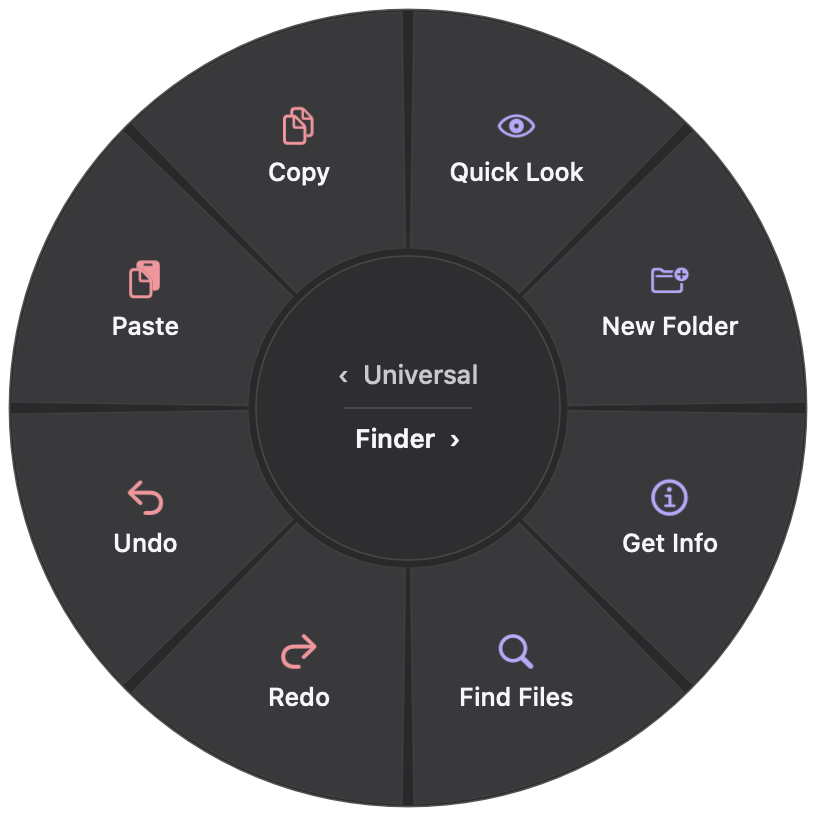

# Mouse Tools

Open **Mouse Tools → Configure Mouse Tools** in the suite, or open **Shad Mouse** from Applications. Turn on **Enable Mouse Tools**. Use **Allow Access…** if macOS requests Accessibility or Input Monitoring for the edition you are running. One switch enables the dial and all four gestures. Shad keeps the bindings active while it runs. **Start at login** is available in the app’s shortcut settings.

## Choose your mouse button

The default for both features is **Middle Click**. Tap the wheel to open the dial at the pointer, then click one of its eight actions. Hold the same button, move up, down, left or right, then release to run that direction’s gesture. Adjust **Gesture distance** to change how far you must move. A shared trigger uses movement for gestures and a tap for the dial.

For separate controls, open **Buttons** and choose a different **Dial button** and **Gesture button**. Then you can also hold the dial button, point at an action and release over it. A tap leaves the dial open for a click. Click its center, press Escape or click outside to dismiss it.

**Learn…** accepts middle, right, side and additional button events macOS receives. For a simple mouse, choose **Option + Left Click** or another modified click. To use a mouse button that emits a keyboard shortcut through its driver, assign it an unused function key or modified shortcut, then learn it here. For a held gesture, the driver needs to keep the key down until the button is released. A mouse control handled entirely inside firmware, such as a DPI switch, needs a driver mapping before macOS can report it. The same button numbers apply across connected mice.

**Control + Option + Command + M** also opens the dial from the suite or standalone app. To change the keyboard binding, find **Show Mouse Dial** in Shad’s shortcut settings. The keyboard command can open the dial before you enable physical button mapping.

## Customize the dial

In **Dial**, select a slot, give it a name, record its keyboard shortcut and save. The left four actions are shared by every app. The right four are selected for the foreground app when the dial opens. The defaults include Finder, TextEdit and common browsers. Choose an app to customize its shortcuts, or edit **Default for other apps**. The ring stays within the display under the pointer and follows Shad’s light or dark appearance.

The universal defaults are Copy, Paste, Undo and Redo. For example, the first right-hand action is **Quick Look** in Finder and **New Tab** in Safari. The action is sent to the same foreground app you opened the ring over. An application switch dismisses the ring.

## Customize gestures

In **Gestures**, select a direction and record a shortcut. The default directions are Go to Top, Go to Bottom, Go Back and Go Forward. Turn on **Use custom gestures** for a selected application to give it its own assignments. One hold runs at most one direction. If the dial and gesture use separate buttons, clicking the gesture button without moving leaves the foreground app alone.

The suite and standalone app share settings. When both run, one handles the physical input. Your assigned shortcuts work wherever the receiving app or macOS supports those shortcuts.

## Logitech references

Logitech documents opening its Actions Ring, selecting an action, and assigning the ring to a compatible mouse button or keyboard shortcut. Its gesture control uses a held button and four directions. [MX Master 4 guide](https://support.logi.com/hc/en-us/articles/28321445268247-Getting-Started-MX-Master-4) · [Actions Ring](https://support.logi.com/hc/en-us/articles/17844647906967-Logi-Options-Actions-Ring) · [Logitech gesture guide](https://www.logitech.com/en-us/discover/a/mouse-gestures-setup)
